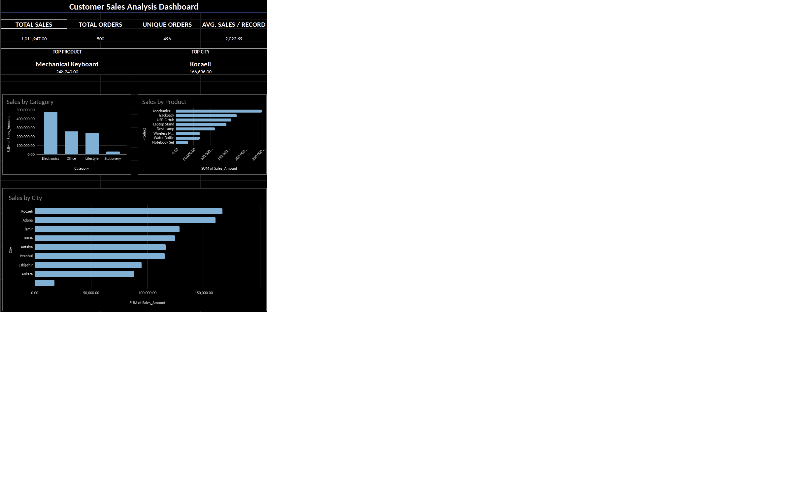

# Customer Sales Data Cleaning & Analysis

## Project Overview

A Google Sheets portfolio project demonstrating data cleaning, quality assurance, sales analysis, and dashboard development using a synthetic e-commerce dataset.

## Dataset

- 500 sales records
- 13 data columns
- Synthetic customer and transaction data

## Data Cleaning & Quality Assurance

- Identified and corrected 29 customer name whitespace issues.
- Corrected 16 identifiable email formatting issues.
- Identified 11 missing city values and 10 missing payment methods.
- Flagged 4 duplicate Order ID pairs with conflicting email information.
- Validated sales calculations across all 500 records with no calculation errors detected.

Missing information and conflicting records requiring external verification were preserved.

## Analysis & Key Findings

| Metric | Result |
|---|---|
| Total Recorded Sales | 1,011,947.00 |
| Sales Records | 500 |
| Unique Order IDs | 496 |
| Average Sales per Record | 2,023.89 |
| Top Product | Mechanical Keyboard |
| Top Product Sales | 248,240.00 |
| Top City | Kocaeli |
| Top City Sales | 166,636.00 |

## Tools & Skills

Google Sheets, data cleaning, TRIM, PROPER, SUBSTITUTE, COUNTIF, data validation, Pivot Tables, KPI analysis, and dashboard visualization.

## Data Limitations

Reported sales figures include unresolved duplicate Order ID records and are not verified unique-order revenue. The dataset is synthetic and was created for learning and portfolio demonstration purposes.
README.md dosyasına eklenecek Markdown
Dashboard Preview
 Kopyala
## Dashboard Preview

